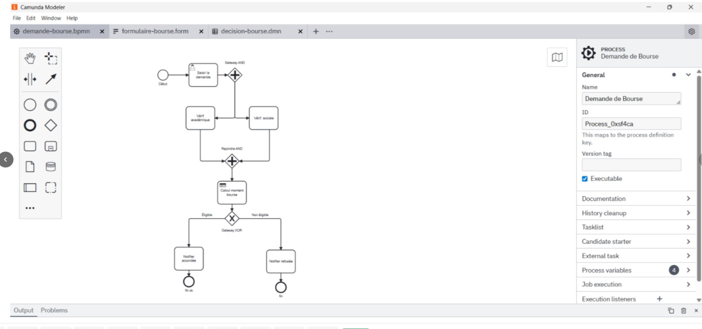
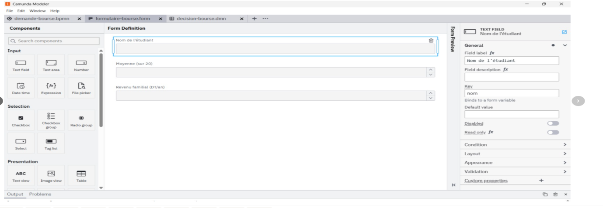
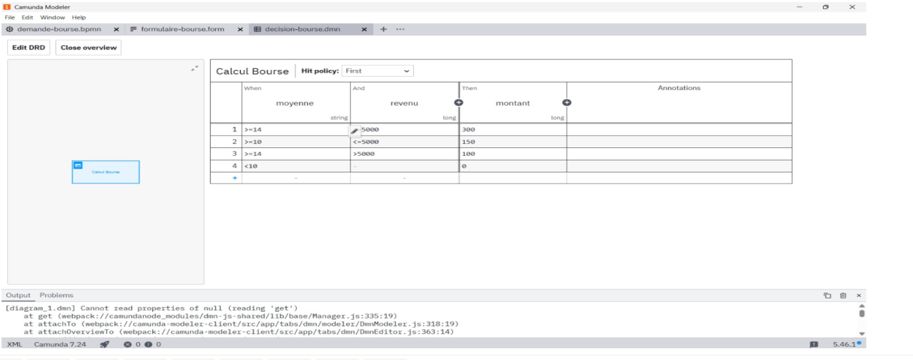

# Processus BPM : demande de bourse universitaire (Camunda)

Projet de BPM (Business Process Management) réalisé avec **Camunda Platform 7.18.0**, en 2ᵉ année Licence BI à l'ISG Tunis (2025/2026), encadré par Pr. Lamia Labed Jilani. Projet réalisé en binôme.

## Objectif
Modéliser, automatiser et exécuter le processus de demande de bourse universitaire : saisie de la demande, vérifications en parallèle, calcul automatique du montant, décision et notification de l'étudiant.

## Déroulement du processus
1. L'étudiant remplit un formulaire (nom, moyenne, revenu familial)
2. Une passerelle parallèle (AND) lance deux vérifications simultanées : dossier académique et dossier social
3. Une seconde passerelle attend la fin des deux vérifications
4. Une table de décision **DMN** calcule le montant de la bourse
5. Une passerelle exclusive (XOR) oriente vers « Éligible » ou « Non éligible »
6. L'étudiant est notifié (bourse accordée ou refusée)

## Diagramme BPMN

## Formulaire de saisie
Trois champs : nom de l'étudiant (`nom`), moyenne sur 20 (`moyenne`) et revenu familial en DT/an (`revenu`).

## Table de décision DMN (Hit Policy : First)
| Moyenne | Revenu (DT/an) | Montant (DT/mois) |
|---|---|---|
| ≥ 14 | ≤ 5000 | 300 |
| ≥ 10 | ≤ 5000 | 150 |
| ≥ 14 | > 5000 | 100 |
| < 10 | toute valeur | 0 (refus) |

## Exemples de tests
| Étudiant | Moyenne | Revenu (DT) | Montant | Résultat |
|---|---|---|---|---|
| Ahmed | 15 | 4000 | 300 DT | Bourse accordée |
| Sara | 8 | 6000 | 0 DT | Bourse refusée |
| Karim | 12 | 4500 | 150 DT | Bourse accordée |

## Outils
Camunda Modeler (BPMN, DMN, Form Editor), Camunda BPM Run 7.18.0, Cockpit, Tasklist, base H2

## Fichiers
- `demande-bourse.bpmn` : diagramme du processus
- `formulaire-bourse.form` : formulaire de saisie
- `decision-bourse.dmn` : table de décision
- `Rapport_Projet_BPM_Camunda.pdf` : rapport complet du projet

## Auteures
Rawen Houimli et Chaima Gmati
